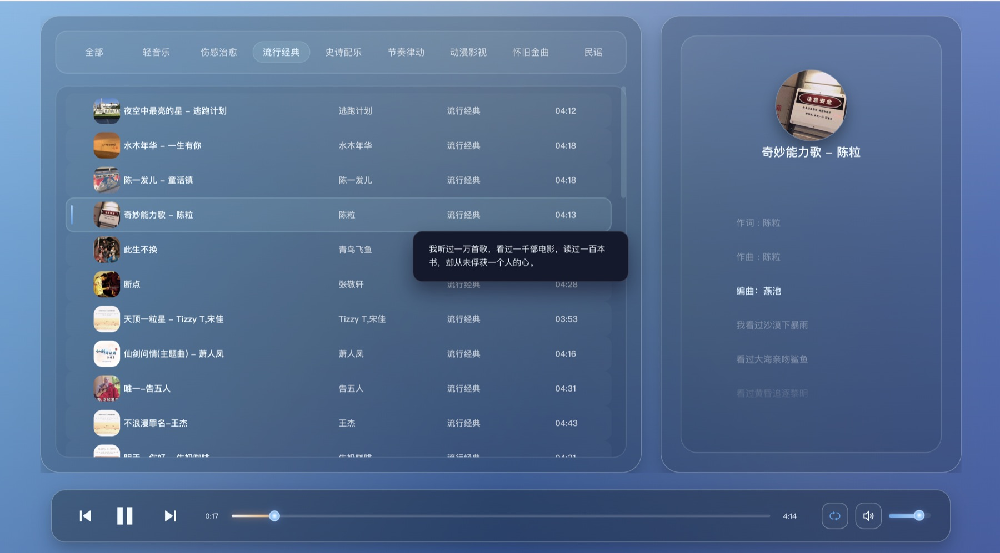
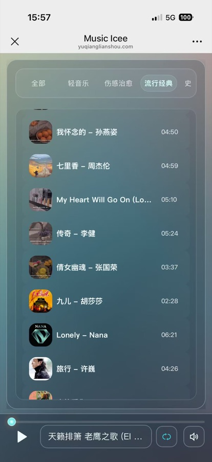
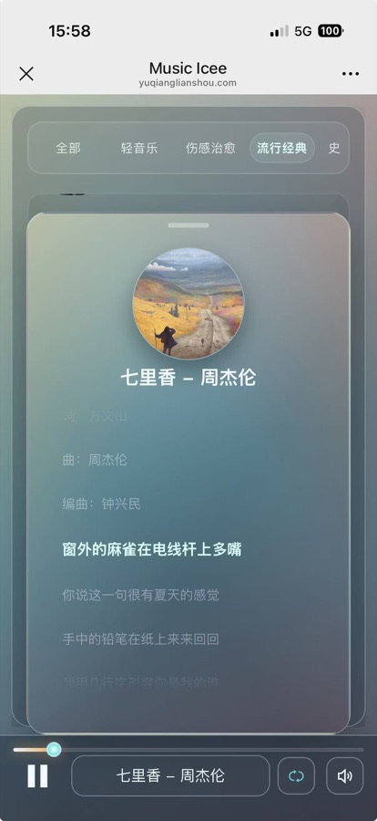

# music_ice
网页版个人音乐播放器

线上地址：[yuqianglianshou.com/music_ice/](https://yuqianglianshou.com/music_ice/)

## 运行界面

桌面端：



移动端：

<p>
  
  
</p>

## 目录结构

```txt
.
├── index.html
├── manifest.webmanifest       # PWA 清单（添加到主屏幕）
├── sw.js                      # Service Worker（缓存页面与图片，音频不缓存）
├── assets/
│   ├── icons/                 # 网站图标与 PWA 图标（SVG 图标已内联在 index.html）
│   ├── picture/               # README 项目截图
│   └── covers/
│       ├── defaults/          # 默认封面原图
│       ├── defaults/thumbs/   # 默认封面列表缩略图
│       └── music-thumbs/      # 歌曲封面列表缩略图
├── css/                       # 页面样式
├── app/                       # 页面逻辑
├── catalog/                   # 按分类拆分的歌单数据
├── scripts/                   # 缩略图生成、歌单校验脚本（需要 Node 22+）
└── media/                     # 音频、歌词、歌曲封面原资源
```

## 命名约定

- JS 模块统一使用 kebab-case，例如 `lyrics-manager.js`、`music-store.js`。
- 歌单数据按分类拆分到 `catalog/`。分类的 id、名称、资源目录、歌单文件和 tab 顺序统一在 `catalog/categories.js` 的 `CATEGORY_META` 中维护，页面、导入工具和校验脚本共用；`catalog/index.js` 把它和各歌单数组组装成 `CATEGORIES`。
- 新增分类：在 `CATEGORY_META` 中追加一项，新建 `catalog/xxx.js`（只导出一个歌单数组），再在 `catalog/index.js` 的 `LISTS_BY_ID` 中登记歌单数组，最后运行 `node scripts/validate-catalog.mjs` 核对。
- 歌单条目只写歌曲自身信息（`song_name`、`song_file`、`img_file`、`lyrics_file`、`author`、`time`、`des`），纯音乐用 `instrumental: true` 代替 `lyrics_file`；分类名称和资源目录 `media/<分类目录>/` 由条目所在的歌单文件决定。
- 页面通用静态资源统一放在 `assets/` 下。

## 生成封面缩略图

添加歌曲封面大图到 `media/` 对应分类目录后，运行：

```bash
node scripts/generate-thumbnails.mjs
```

脚本会读取 `catalog/index.js` 汇总的歌单中的 `img_file`，自动生成缺失或过期的 `assets/covers/music-thumbs/**/*.jpg` 列表小图。
如需同时更新默认封面缩略图，可追加 `--defaults`。

## 校验歌单

新增、迁移或改名歌曲后，运行：

```bash
node scripts/validate-catalog.mjs
```

检查歌单引用的音频、封面、歌词是否存在（文件名必须逐字一致，仅大小写或 Unicode 组合方式不同也会报错，避免线上 404），并提示缺少 `des`、缺少缩略图、`media/` 下未被引用的残留文件等问题。有错误时退出码为 1。
追加 `--durations` 会用 `ffprobe` 核对 `time` 字段与音频实际时长。

## PWA 与缓存

页面可在 Android Chrome 中“添加到主屏幕”。`sw.js` 的缓存策略：

- 音频不经过 Service Worker（避免 Range 分段请求被缓存导致播放中断）。
- 页面、JS、CSS、歌单、歌词：网络优先，离线时用缓存兜底，线上更新立即生效。
- 图片：先用缓存，后台刷新；替换同名封面后，下次打开显示新图。

注意：`python3 -m http.server` 不支持 Range 请求，本地调试时音频无法拖动进度，线上静态服务器不受影响。

## 本地导入工具

通过 `tools/import-song.html` 可以在浏览器里直接把歌曲、歌词、封面写入项目：

1. 在仓库根目录启动普通静态服务：

   ```bash
   python3 -m http.server 8000
   ```

2. 打开导入页面：

   ```txt
   http://localhost:8000/tools/import-song.html
   ```

3. 点击“选择项目目录”，选择当前 `music_ice` 仓库根目录并授权。
4. 选择分类，填写歌曲名、作者、描述等信息。
5. 可以点击“选择歌曲文件夹”自动填充歌曲、歌词和封面，也可以分别选择单个文件。
6. 确认“写入预览”无误后，点击“添加歌曲”。

工具会自动：

- 把文件写入 `media/对应分类/`
- 把条目追加到 `catalog/对应分类.js`
- 为封面生成 `assets/covers/music-thumbs/` 列表缩略图

注意：导入工具不建议使用 VS Code Live Server 打开。Live Server 会监听文件变化并自动刷新页面，导入过程中写入 `media/`、`catalog/` 或 `assets/` 文件时可能中断导入流程。使用上面的 `python3 -m http.server 8000` 普通静态服务更稳定。
